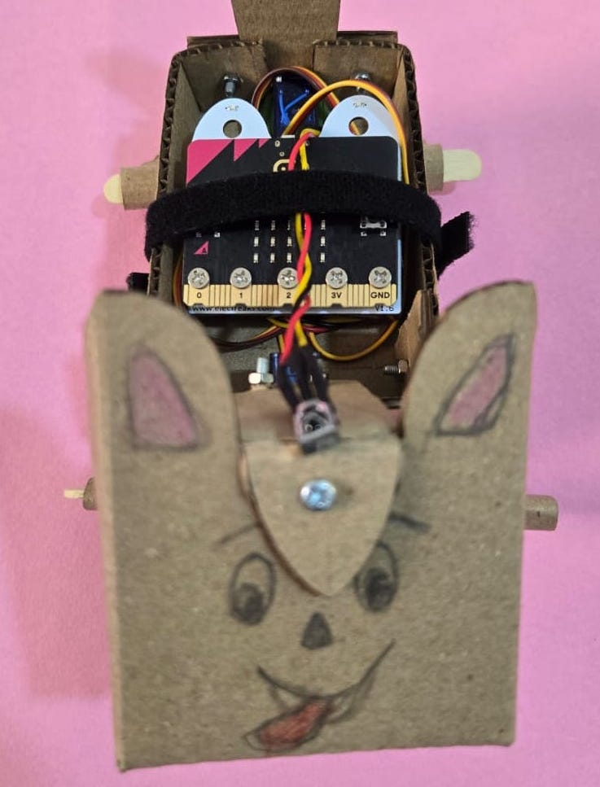

# DIY Robot Dog Kit

Robot Dog is an exciting and fun project for DIY robot builders. The robot only uses two servo motors yet it is able to accomplish full walking cycle and you can move it in four directions.

